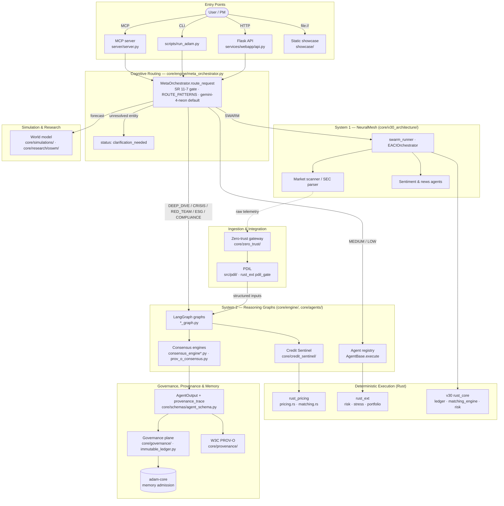
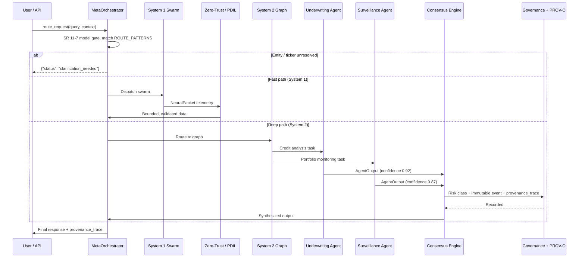

---

<div align="center">
  <a href="https://adamvangrover.github.io/adam/">
    <picture>
      <source media="(prefers-color-scheme: dark)" srcset=".github/images/logo-dark.svg">
      <source media="(prefers-color-scheme: light)" srcset=".github/images/logo-light.svg">
      
    </picture>
  </a>
</div>

<div align="center">
  <h3>Autonomous Deterministic Alpha Matrix</h3>
  <p><em>The Institutional-Grade Neuro-Symbolic Financial Sovereign</em></p>
</div>

<div align="center">
  <a href="https://opensource.org/licenses/MIT" target="_blank"></a>
  <a href="https://www.python.org/downloads/" target="_blank"></a>
  <a href="https://hub.docker.com/" target="_blank"></a>
  <a href="AGENTS.md"></a>
  <a href="docs/setup_guide.md"></a>
</div>

<br>

**Version:** 30.1 &nbsp;|&nbsp; **Focus:** Neuro-Symbolic DAG Orchestration &nbsp;|&nbsp; **Domain:** Institutional credit risk & market intelligence

---

## Table of Contents

- [Overview](#overview)
- [Start Here](#-start-here)
- [Quick Links](#-quick-links)
- [Why ADAM?](#-why-adam-the-system-2-revolution)
- [System Architecture](#-system-architecture)
- [Agent Communication Flow](#-agent-communication-flow)
- [Ecosystem & Capabilities](#-ecosystem--capabilities)
- [Credit Risk Pipeline](#%EF%B8%8F-step-by-step-credit-risk-automation)
- [Tech Stack](#%EF%B8%8F-tech-stack)
- [Getting Started](#-getting-started)
- [Using the Orchestrator](#-using-the-orchestrator)
- [Tests, Evals & Benchmarks](#-tests-evals--benchmarks)
- [Templates & Brands](#-templates--brands)
- [Directory Structure](#-directory-structure)
- [Human Oversight & Governance](#%EF%B8%8F-human-oversight--governance)
- [Known Issues](#-known-issues--current-work)
- [Roadmap](#%EF%B8%8F-roadmap-path-to-autonomy)
- [Contributing](#-contributing)
- [Glossary](#-glossary)
- [FAQ](#-frequently-asked-questions)
- [For AI Agents & LLMs](#-for-ai-agents--llms)

---

## Overview

ADAM is a **local-first, multi-agent framework** that keeps LLM reasoning bounded by deterministic risk
engines, externalized rules (JSONLogic/YAML) and W3C PROV-O provenance. It orchestrates asynchronous data
pipelines to combine semantic market sentiment with rules-based credit surveillance, built for
privacy-by-design environments.

**The core thesis:** LLM-driven semantic analysis is only actionable when bounded by deterministic risk
models. ADAM is the orchestration layer that does this at scale: every agentic workflow resolves into a
typed, verifiable `AgentOutput` with a `provenance_trace`. Target workloads:

- **Broadly Syndicated Loans (BSL)** and **CLO** structuring
- **Distressed Debt** triage and recovery analysis
- **Deep Credit Risk Underwriting** across complex verticals (TMT, Software, Healthcare)

The repository is also a **template library**: its many brands, products, newsletters and terminal pages
are modular defaults you copy and refine to taste — see [Templates & Brands](#-templates--brands).

> [!NOTE]
> Looking for the web interface? Open the [Showcase](showcase/index.html), the
> [Dashboard Catalog](showcase/dashboards/index.html) or the [System Portal](index.html). No backend needed.

---

## 🧭 Start Here

| You are | Read |
|---|---|
| New contributor / model ingesting the repo | [`REPO_MAP.md`](REPO_MAP.md) (where everything is), [`machine_index.json`](machine_index.json), [`llms.txt`](llms.txt) |
| Building agents | [`AGENTS.md`](AGENTS.md), [`core/agents/templates/v30_template_agent.py`](core/agents/templates/v30_template_agent.py) |
| Understanding the flow | [`docs/ARCHITECTURE.md`](docs/ARCHITECTURE.md) |
| Setting up any slice (orchestrator, credit, Rust, frontend, Docker) | [`docs/setup_guide.md`](docs/setup_guide.md) |
| Working on System 1 / v30 | [`core/v30_architecture/README.md`](core/v30_architecture/README.md) |
| Auditing outputs | [`docs/PROVENANCE.md`](docs/PROVENANCE.md) |
| Picking a starting template (brand, newsletter, terminal, prompt) | [`docs/TEMPLATES.md`](docs/TEMPLATES.md) |

---

## 📚 Quick Links

| Resource | Description |
|:---------|:------------|
| [🗺️ Repo Map](REPO_MAP.md) | Canonical tree, entry points, config registry, snapshot index |
| [📖 Architecture](docs/ARCHITECTURE.md) | Request flow and layer contracts |
| [🧾 Provenance](docs/PROVENANCE.md) | `provenance_trace`, `_estimated` convention |
| [⚡ Setup Guide](docs/setup_guide.md) | Per-slice installation (minimal → full stack) |
| [🤖 Agent Guide](AGENTS.md) | Agent contract, swarm protocol, persona catalog (v30.1) |
| [🧠 Agent Knowledge Base](docs/AGENTS_KNOWLEDGE_BASE.md) | Accumulated agent learnings and traps |
| [🗂️ Agent Catalog](AGENT_CATALOG.md) | Registry of all agents |
| [🧩 Template Library](docs/TEMPLATES.md) | Brands, newsletters, terminals, prompts, doc templates |
| [🖥️ Showcase](showcase/README.md) | Static dashboards and how the manifest classifies them |
| [🎓 Tutorials](docs/tutorials.md) | Step-by-step walkthroughs |
| [📦 Custom Builds](docs/custom_builds.md) | Modular deployment bundles (`scripts/build_adam.py`) |
| [🏗️ Three-Layer Architecture](docs/LAYERS.md) | Execution layer breakdown |
| [🧪 Evals](tests/evals/) | Routing / entity datasets + `run_accuracy.py` |
| [🔒 Security Policy](SECURITY.md) | Vulnerability reporting and security model |
| [📋 Changelog](CHANGELOG.md) | Version history |

---

## 🧠 Why ADAM? The "System 2" Revolution

Stochastic models hallucinate, which makes them dangerous for due diligence. ADAM separates reasoning
from execution: LLMs interpret, deterministic engines calculate, and a probabilistic-to-deterministic
layer (PDIL, `src/pdil/`; Rust gate in `rust_ext/src/pdil_gate.rs`) sits between them.

### ⚡ System 1: The Swarm (The Reflexes)

| Attribute | Detail |
|:----------|:-------|
| **Role** | High-velocity, unstructured data parsing and asynchronous surveillance |
| **Focus** | Continuous extraction from 13F, 13D and Form 4 SEC EDGAR filings, news and market telemetry |
| **Architecture** | NeuralMesh pub/sub (`core/v30_architecture/python_intelligence/`) |
| **Base Class** | `BaseAgent` (v30, `run()` + `emit()` → `NeuralPacket`); legacy `AsyncAgentBase` in `core/system/v22_async/` |
| **Output** | Telemetry only — nothing binding without System 2 |
| **Example** | "Monitor TMT sector for cash burn spikes and publish corporate structural changes as packets." |

### 🧠 System 2: The Graph (The Deep Thinker)

| Attribute | Detail |
|:----------|:-------|
| **Role** | Downside scenario stress testing, capital structure analysis, covenant compliance |
| **Focus** | "Logic as Data" — JSONLogic rules in `assets/`, thresholds in `config/*.yaml` |
| **Architecture** | `MetaOrchestrator` + LangGraph graphs (`core/engine/*_graph.py`), Neuro-Symbolic Planner |
| **Base Class** | `TemplateAgentV30` (`core/agents/templates/v30_template_agent.py`) |
| **Output** | `AgentOutput` with `confidence` tier and `provenance_trace` |
| **Example** | "Route extracted parameters into non-LLM pricing engines to produce a deep-dive credit memo with Base/Bull/Bear DCF scenarios." |

---

## 📐 System Architecture



Flat text version with layer contracts: [`docs/ARCHITECTURE.md`](docs/ARCHITECTURE.md).

---

## 🔄 Agent Communication Flow

All inter-agent communication follows deterministic protocols to prevent circular dependencies and keep
every result auditable.



> [!IMPORTANT]
> Agents must **never** instantiate other agents directly. Cross-domain requests go back through the
> orchestrator via output metadata: `metadata={"next_step": "invoke_surveillance", "query": "verify_covenant_compliance"}`.
> Confidence tiers (`config/agent_schema.yaml`): ≥ 0.85 autonomous, 0.50–0.8499 human approval, < 0.50 abort.

---

## 🌐 Ecosystem & Capabilities

### 🤖 Specialized Agents (`core/agents/`)

| Domain | Agents |
|:-------|:-------|
| **Risk & Credit** | `CreditRiskAgent`, `SNCAnalystAgent`, `LiquidityRiskAgent`, covenant agent (`core/credit_sentinel/covenant_agent.py`) |
| **Quantitative & Market** | `AlgoTradingAgent`, `OptionsFlowAgent`, `QuantumPortfolioManagerAgent`, `MarketMakingAgent` |
| **Macro & Alt Data** | `BlackSwanAgent`, `MacroeconomicAnalysisAgent`, `GeopoliticalRiskAgent`, `AlternativeDataAgent` |
| **Governance & Security** | `RedTeamAgent`, `DataVerificationAgent`, `FraudDetectionAgent`, compliance graph (`core/engine/regulatory_compliance_graph.py`) |

> See [AGENT_CATALOG.md](AGENT_CATALOG.md) for the registry and [AGENTS.md](AGENTS.md) §4/§8 for state schemas and personas.

### 🧰 Core Engines & Components (`core/`)

| Component | Path | What it does |
|:----------|:-----|:-------------|
| MetaOrchestrator | `core/engine/meta_orchestrator.py` | `Route` enum, `OrchestratorConfig`, word-boundary routing, clarification fallback |
| Reasoning graphs | `core/engine/*_graph.py` | Deep dive, crisis simulation, red team, ESG, regulatory compliance, SNC, reflector, surveillance |
| Consensus engines | `core/engine/consensus_engine*.py`, `risk_consensus_engine.py`, `prov_o_consensus.py` | Weighted votes + HITL, house view, SNC risk, PROV-O corroboration |
| Zero-trust ingestion | `core/zero_trust/` | Gateway, schema bounds, triangulated 3-feed consensus with lockdown |
| Credit Sentinel | `core/credit_sentinel/` | Distressed debt analysis, covenants, ingestion |
| Governance | `core/governance/` | Policy, invariants A–J, risk classes, approval, immutable ledger |
| Provenance | `core/provenance/` | PROV-O helpers, hashing, lineage, exporter |
| MCP | `server/server.py`, `mcp.json` | Tool surface for MCP clients |
| Standalone credit engine | [`showcase/index.html`](showcase/index.html) | Portable HTML/JS sensitivity model; no backend |
| Rust kernels | `adam-core/`, `core/rust_pricing/`, `rust_ext/`, `core/v30_architecture/rust_core/` | Deterministic pricing, matching, risk, memory |

### 🔬 Evaluation Harnesses

| Harness | Path | Covers |
|:--------|:-----|:-------|
| Accuracy evals (gated in CI) | `tests/evals/` | Query → route and query → entity datasets with accuracy floors |
| Gold-standard harness | `evals/` | PROV-O compliance, authorization boundaries, RAG accuracy, adversarial red-teaming |
| Regression seams | `tests/regression/` | One seam test per fixed bug |

---

## ⚙️ Step-by-Step Credit Risk Automation

To keep the process auditable, the credit pipeline executes as a strict sequence:

```
┌─────────────────┐    ┌───────────────────────┐    ┌──────────────────────┐
│  1. INGESTION   │───▶│  2. SEMANTIC-TO-DET.  │───▶│  3. GRAPH TRAVERSAL  │
│  System 1 parses│    │  Zero-trust + PDIL map│    │  Knowledge graph     │
│  13F, 13D, 10-K │    │  signals into Pydantic│    │  (FIBO) counterparty │
│  filings        │    │  / JSON schemas       │    │  exposure            │
└─────────────────┘    └───────────────────────┘    └──────────────────────┘
                                                              │
┌─────────────────┐    ┌───────────────────────┐              │
│  5. OUTPUT      │◀───│  4. MATH EXECUTION    │◀─────────────┘
│  Credit memo +  │    │  Deterministic Python │
│  provenance_    │    │  / Rust compute PD,   │
│  trace + ledger │    │  LGD, VaR             │
└─────────────────┘    └───────────────────────┘
```

1. **Ingestion & Parsing:** System 1 ingests 13F, 13D, 10-K and earnings transcripts, sanitizing text to extract hard numbers.
2. **Semantic → Deterministic Mapping:** `core/zero_trust/` bounds and triangulates feeds; PDIL (`src/pdil/`) maps qualitative flags into predefined schemas.
3. **Knowledge Graph Traversal:** Graph queries over the FIBO-aligned knowledge graph (`core/engine/unified_knowledge_graph.py`, `config/knowledge_graph*.yaml`) identify counterparty exposure.
4. **Mathematical Execution:** Deterministic engines (`core/credit_sentinel/`, `core/rust_pricing/`, `rust_ext/`) compute PD, LGD and VaR from validated schemas only — the LLM never does arithmetic (Invariant A).
5. **Output Generation:** The final memo or regulatory rating is an `AgentOutput` with a `provenance_trace`; the state change is risk-classified and written to the immutable ledger (`core/governance/`).

---

## 🛠️ Tech Stack

| Layer | Technology | Purpose |
|:------|:-----------|:--------|
| **Deterministic Execution** | Rust (PyO3 / maturin) | Pricing kernels, matching engines, PDIL gate, memory admission |
| **Orchestration & Agents** | Python 3.12 (3.11+) / Pydantic v2 / LangGraph | Async swarm, DAG graphs, typed I/O |
| **Default LLM** | `gemini-4-neon` | `OrchestratorConfig` default; override in `config/llm_routing.yaml` tier 1 |
| **Governance & Rules** | JSONLogic / YAML | "Logic as Data" — covenants, thresholds, business rules |
| **Frontend & Visualization** | HTML / React / Three.js | Showcase dashboards, terminals, React client (`services/webapp/client/`) |
| **Knowledge Representation** | Knowledge graph / FIBO ontology / Neo4j | Entity relationships, counterparty mapping |
| **Memory & Search** | Qdrant | JIT semantic search over filings and history |
| **Package Management** | `uv` | Reproducible Python environments (`uv.lock`) |
| **Containerization** | Docker / Docker Compose | Multi-service deployment (`docker-compose*.yml`) |

---

## ⚡ Getting Started

We use **`uv`** with **Python 3.12** (`requires-python = ">=3.11,<3.13"`). Rust, Docker and Node are optional.

### Prerequisites

| Requirement | Details |
|:------------|:--------|
| **OS** | Linux, macOS, or Windows (WSL2) |
| **Tooling** | [`uv`](https://astral.sh/uv) |
| **Python** | 3.12 recommended (3.11 supported) |
| **API Keys** | Optional. Without a key the orchestrator falls back to mock behaviour. Copy `.env.example` → `.env` |
| **Optional** | Docker (full stack), Rust/cargo (kernels), Node (React client) |

### Quick Start

```bash
# 1. Install uv (if not installed)
curl -LsSf https://astral.sh/uv/install.sh | sh

# 2. Clone
git clone https://github.com/adamvangrover/adam.git && cd adam

# 3. Create a Python 3.12 env and sync
uv venv --python 3.12
uv sync --extra data-science --extra orchestration   # or --extra full-kernel / --extra risk-agent

# 4. Launch
uv run python scripts/run_adam.py
```

`requirements/base.txt` has conflicting pins; if `uv sync` fails, install the failing imports individually
(`uv pip install <pkg>`). SR 11-7 blocked models (`core/config/models.py::BLOCKED_MODELS`) are refused at startup.

### Other entry points

```bash
docker compose up -d                                         # full stack (API :5001, client :80)
docker compose -f docker-compose.yml -f docker-compose.agents.yml -f docker-compose.infra.yml up -d
cargo test --manifest-path adam-core/Cargo.toml              # Rust memory slice
python -m core.v30_architecture.python_intelligence.agents.swarm_runner   # System 1 swarm (:8001)
```

Per-slice recipes (orchestrator only, credit_sentinel only, Rust, frontend, Docker):
[`docs/setup_guide.md`](docs/setup_guide.md).

### Standalone usage (no backend)

Open [`showcase/index.html`](showcase/index.html) or the [dashboard catalog](showcase/dashboards/index.html)
in any browser — no Python or Rust needed.

---

## 🧩 Using the Orchestrator

```python
import asyncio
from core.engine.meta_orchestrator import MetaOrchestrator

orch = MetaOrchestrator()
print(asyncio.run(orch.route_request("Simulate a market crash", context={"portfolio": {"aum": 1e6, "allocation": {"SPY": 0.6, "TLT": 0.4}}})))
```

Queries route by ordered word-boundary patterns (deep dive, swarm, code gen, red team, crisis,
surveillance, ESG, compliance, family-office wealth/deal/execution/market, HIGH/MEDIUM/LOW). Queries
without a resolvable ticker or entity return `{"status": "clarification_needed"}`.

---

## 📊 Tests, Evals & Benchmarks

```bash
.venv/bin/python -m pytest tests/ -q          # everything
.venv/bin/python -m pytest tests/unit -q      # module tests
.venv/bin/python -m pytest tests/regression -q
.venv/bin/python tests/evals/run_accuracy.py  # routing + entity accuracy vs. floors
.venv/bin/ruff check <changed files>
```

Some suites need optional dependencies and fail to collect without them.

**Measured in-repo:** `tests/evals/run_accuracy.py` prints routing and entity accuracy against the floors
in that file and exits non-zero below them.

**Reported targets (historical, not reproduced by CI):**

| Metric | Target | Method |
|:-------|:-------|:-------|
| FinanceBench accuracy | 99% | Deterministic calculation verification (no LLM arithmetic) |
| Pricing engine latency | < 5 ms | Rust-backed VaR / DCF / Monte Carlo, releases the GIL |
| 10-K ingestion | < 12 s | SEC filing → ontology mapping → vector store |
| Deterministic drift | 0% | Covenant stress tests via JSONLogic, isolated from stochastic models |

Treat these as design goals until a benchmark script under `benchmarks/` or `tests/evals/` reproduces them.

---

## 🎨 Templates & Brands

ADAM ships many brands, products, newsletters and terminal pages. **None is the canonical voice** —
they are starting templates: pick one, copy it, refine to taste. The full catalog with paths, what to copy
and what to customize is in **[`docs/TEMPLATES.md`](docs/TEMPLATES.md)**.

### Branded Applications

| Project | Description | Location |
|:--------|:------------|:---------|
| **Market Mayhem** | Macro / cross-asset / credit intelligence newsletter and dashboards: tail risks, contagion, macro shocks | `market-mayhem/` (skill + templates), `newsletters/`, `public/market-mayhem/`, `showcase/dashboards/market_mayhem*.html` |
| **Project Fortress** | Automated credit risk underwriter tuned for BSL and CLOs | `core/credit_sentinel/`, `briefings/fortress_hunt*.md` |
| **Project Hunt** | Multi-asset alpha generation: 13F/13D scanning for deep-value catalyst detection | `core/agents/`, `prompt_library/AOPL-v2.0/professional_outcomes/ADAM_v30_1_R_Hunt_and_Kill_Orchestrator_Prompt.md` |
| **Analyst OS / terminals** | Workstation and terminal UIs (v30.x, v31.0 cyber-retro) | `showcase/analyst_os*.html`, `showcase/dashboards/adam_v3*_*.html`, `terminals/` |
| **Brand pages** | Landing pages per brand | `docs/brands/*.html`, `public/*/` |

### Template families

| Family | Where | Catalog section |
|:-------|:------|:----------------|
| Doc templates (agent, data source, workflow) | `docs/templates/` | [TEMPLATES §1](docs/TEMPLATES.md#1-documentation-templates) |
| Brand / product pages | `docs/brands/`, `public/`, `showcase/dashboards/` | [TEMPLATES §2](docs/TEMPLATES.md#2-brand--product-pages) |
| Newsletters & reports | `showcase/Daily_Briefing_*`, `Market_Pulse_*`, `House_View_*`, `market-mayhem/templates/` | [TEMPLATES §3](docs/TEMPLATES.md#3-newsletter--report-families) |
| Terminals | `showcase/dashboards/adam_v30_*`, `adam_v31_0_*`, `terminals/` | [TEMPLATES §4](docs/TEMPLATES.md#4-terminal-variants) |
| Prompts | `prompt_library/AOPL-v1.0/`, `AOPL-v2.0/`, `prompt_library/templates/` | [TEMPLATES §5](docs/TEMPLATES.md#5-prompt-templates) |

### Standalone Components

- **Credit Sensitivity Engine:** [`showcase/index.html`](showcase/index.html) — pure HTML/JS credit model, zero backend dependencies
- **Prompt-as-Code Library:** copy any prompt from [`prompt_library/`](prompt_library/) into LangChain, AutoGen or CrewAI workflows
- **Custom builds:** `python3 scripts/build_adam.py` exports selected modules as Lite/Standard/Full bundles ([docs](docs/custom_builds.md))

---

## 📂 Directory Structure

```text
adam/
├── core/                       # Canonical Python package
│   ├── agents/                 #   System 2 agents (AgentBase subclasses); templates/ = TemplateAgentV30
│   ├── credit_sentinel/        #   Distressed debt analysis (covenants, ingestion) — Project Fortress
│   ├── engine/                 #   MetaOrchestrator, LangGraph graphs, consensus, simulation
│   ├── schemas/                #   agent_schema.py = AgentInput / AgentOutput (the one contract)
│   ├── governance/             #   Policy, invariants, risk classes, immutable ledger
│   ├── provenance/             #   W3C PROV-O helpers, hashing, lineage
│   ├── zero_trust/             #   Zero-trust ingestion gateway, triangulated consensus
│   ├── v30_architecture/       #   System 1 NeuralMesh swarm + Rust core (forward path)
│   ├── experimental/           #   Live lab code (adamos_kernel crate)
│   └── system/                 #   Swarm infrastructure, memory, v22 async base
├── adam_os/ adam_swarm/ adam_finance/ adam_governance/ adam_graph/   # Domain packages
├── config/                     # YAML config registry (REPO_MAP §3)
├── assets/                     # JSONLogic rules and externalized prompts
├── schemas/                    # JSON Schemas for cross-runtime use
├── services/webapp/            # Flask API (api.py::create_app) + React client (client/)
├── server/                     # MCP server (tools in mcp.json)
├── src/pdil/                   # Probabilistic-to-Deterministic Integration Layer
├── adam-core/  rust_ext/       # Rust slices (memory; PyO3 risk/stress/PDIL gate)
├── showcase/                   # Static HTML (GitHub Pages): dashboards/, apps/, portal/, reports
│   ├── dashboards/             #   Catalog index.html + manifest.json (scripts/build_dashboard_manifest.py)
│   ├── Daily_Briefing_*.html   #   ~100 daily briefing reports (template family)
│   ├── Market_Pulse_*.html     #   ~65 weekly market pulse reports
│   └── House_View_*.html       #   Monthly house view publications
├── market-mayhem/              # Market Mayhem skill, report templates, standalone publication
├── newsletters/ briefings/ terminals/   # Published newsletters, briefs, terminal snapshots
├── prompt_library/             # Prompt-as-Code (AOPL-v1.0 legacy, AOPL-v2.0 current, templates/)
├── docs/                       # Long-form docs; ARCHITECTURE.md, PROVENANCE.md, TEMPLATES.md, setup_guide.md
│   ├── templates/              #   Agent / data-source / workflow documentation templates
│   └── archive/                #   Historical manuals (v19–v25) — context, not current truth
├── tests/
│   ├── unit/                   #   Module tests
│   ├── regression/             #   One seam test per fixed bug
│   ├── evals/                  #   Datasets + run_accuracy.py (accuracy floors)
│   └── integration/ …          #   Cross-module and domain suites
├── evals/                      # Gold-standard evaluation harness
├── scripts/                    # CLI, generators, maintenance
├── archive/snapshots/          # Frozen codebases (adam_v24, afos_v3, ufos, tinker_lab, experimental); never imported
├── research/                   # Lab research (never imported into core)
├── kubernetes/                 # K8s manifests
├── data/                       # Seed data, ledgers, telemetry
├── REPO_MAP.md                 # Where everything is (read first)
├── AGENTS.md                   # Agent guide (v30.1)
├── AGENT_CATALOG.md            # Agent registry
├── llms.txt                    # LLM-optimized project context
└── machine_index.json          # Machine-readable module manifest
```

The authoritative, status-annotated version of this tree is [`REPO_MAP.md`](REPO_MAP.md) §1.

---

## 🛡️ Human Oversight & Governance

> [!IMPORTANT]
> ADAM automates execution, but **human domain experts remain indispensable** as architects, arbiters and
> legal guardians of the system.

ADAM separates **operational execution** (automated) from **governance** (human-supervised). Every
state-changing operation gets a risk class and an immutable event (`core/governance/`,
`config/governance_policy.yaml`); material decisions carry a `provenance_trace` (`docs/PROVENANCE.md`).

### Where Humans Are Essential

| Function | Why It Can't Be Fully Automated |
|:---------|:-------------------------------|
| **Rule Definition** | Humans define what a "Bear scenario" is, covenant thresholds and risk tolerance — all in YAML/JSONLogic |
| **Black Swan Override** | Novel macro events (pandemics, geopolitical shocks) need judgment outside training data |
| **Regulatory Accountability** | G-SIB regulators require a human fiduciary — "the agent swarm decided" is not a legal defense |
| **System Drift Detection** | Humans sample outputs to detect model degradation and feedback loops |
| **Ethical Guardrails** | Lending decisions, ratings and allocations carry fiduciary and ethical weight |

### Governance Architecture

- **Confidence tiers** (`config/agent_schema.yaml`): ≥ 0.85 autonomous, 0.50–0.8499 human approval (HITL), < 0.50 abort.
- **SR 11-7 model gate:** `BLOCKED_MODELS` raise `SR11_7_BLOCKED_MODEL_ERROR` before any routing.
- **PROV-O telemetry:** `AgentOutput.provenance_trace`; empty trace = ungrounded (`check_grounding()` is False).
- **Invariants A–J:** [`AGENTS.md` §7](AGENTS.md#7-architectural-invariants), `core/governance/invariants.py`.
- **Break-glass overrides:** signed `X-Governance-Override` headers for high-risk endpoints (`services/webapp/governance.py`).
- **Sentinel agent:** terminates executions lacking a provenance header (`AGENTS.md` §4.D).
- **`_estimated: true`:** marks hand-picked placeholder values in config and outputs.

---

## 🚧 Known Issues & Current Work

> This is a bleeding-edge framework at the intersection of quantitative finance and AI.

| Issue | Status | Detail |
|:------|:-------|:-------|
| **Dependency pins** | ⚠️ Known | `requirements/base.txt` pins conflict (opentelemetry); use `uv sync` with extras and install missing imports individually |
| **Optional-dep test collection** | ⚠️ Known | Some suites need torch / flask / fpdf and fail to collect without them |
| **DAG queue bottlenecks** | 🔧 Active | System 2 congestion at high concurrent underwriter counts |
| **PDIL migration** | 🔧 Active | Moving validation from Python (`src/pdil/`) to Rust (`rust_ext/src/pdil_gate.rs`) |
| **Quantum dependencies** | ⚠️ Mocked | `quantum` extra / neuro-quantum experiments need CUDA (`cuQuantum`); mocked in CI |

---

## 🛣️ Roadmap: Path to Autonomy

```
Phase 1               Phase 1.5 (V-NEXT)    Phase 2               Phase 3
━━━━━━━━━━━━━━━━━    ━━━━━━━━━━━━━━━━━━    ━━━━━━━━━━━━━━━━━    ━━━━━━━━━━━━━━━━━
The Autonomous        The Command Center     The Portfolio         The Market Maker
Analyst                                      Manager

• Deep Dives          • Synthesizer UI       • Multi-entity risk   • HF sentiment
• Credit Memos        • Quantum Tail-Risk    • Dynamic covenants     trading
• Regulatory Rating   • 3D Topology Maps     • Auto rebalancing    • Quantum RL
• Edgar Ingestion     • Live Dashboards      • CLO structuring     • Rust matching
```

### Improvement Focus Areas

1. **Agentic market-making harness:** `core/agents/algo_trading_agent.py` emitting Rust-executable `TradeSignal` schemas into the matching engine (`core/rust_pricing/src/matching.rs`).
2. **Self-healing documentation:** generated docs from AST parsing; keep `REPO_MAP.md` and `machine_index.json` in sync with the tree.
3. **Preference optimization (DPO):** HITL overrides on ratings feed fine-tuning of local open-weight models.
4. **Eval coverage:** grow `tests/evals/datasets/` beyond routing and entity resolution.

---

## 🤝 Contributing

| Step | Resource |
|:-----|:---------|
| **1. Find your way** | [REPO_MAP.md](REPO_MAP.md), [docs/ARCHITECTURE.md](docs/ARCHITECTURE.md) |
| **2. Read the rules** | [AGENTS.md](AGENTS.md) — contract, pre-flight checklist, invariants |
| **3. Study the knowledge base** | [Agent Knowledge Base](docs/AGENTS_KNOWLEDGE_BASE.md) — accumulated traps and learnings |
| **4. Follow the process** | [CONTRIBUTING.md](CONTRIBUTING.md) — PR guidelines |
| **5. Understand conduct** | [Code of Conduct](CODE_OF_CONDUCT.md) |

### Architecture Guidelines (v30.1)

- **Front-end isolation:** never import UI libraries (`streamlit`, `react`) inside `core/` or `adam_*/`. Rendering stays in `services/`, `showcase/` or `frontend/`.
- **Strict I/O boundaries:** use `AgentInput` / `AgentOutput` from `core/schemas/agent_schema.py`; no duplicates.
- **Logic as data:** thresholds in `config/*.yaml`, rules in `assets/` JSONLogic.
- **Tests:** `tests/unit/` for modules, `tests/regression/` for bug seams, `tests/evals/` for routing/entity behaviour.
- **Snapshots:** `archive/snapshots/` is read-only history — copy useful code into `core/` with tests, never import it.

---

## 📖 Glossary

| Term | Definition |
|:-----|:-----------|
| **AFOS** | Adam Financial Operating System — the full platform name |
| **BSL** | Broadly Syndicated Loans — large loans originated by banks and syndicated to institutional investors |
| **CLO** | Collateralized Loan Obligation — structured product packaging leveraged loans |
| **DCF** | Discounted Cash Flow — valuation method projecting future cash flows |
| **DPO** | Direct Preference Optimization — learning from human preference feedback |
| **EV** | Enterprise Value — total company valuation metric |
| **FIBO** | Financial Industry Business Ontology — standardized financial data model |
| **FCCR** | Fixed Charge Coverage Ratio — ability to cover fixed obligations |
| **GNN** | Graph Neural Network — neural network on graph-structured data |
| **G-SIB** | Global Systemically Important Bank — banks subject to heightened regulation |
| **HDKG** | HyperDimensional Knowledge Graph — ADAM's structured knowledge output |
| **HITL** | Human-in-the-Loop — confidence 0.50–0.8499 pauses for approval |
| **HNASP** | Hybrid Neurosymbolic Agent State Protocol — JSONLogic + BayesACT persona state |
| **LGD** | Loss Given Default — share of exposure lost if a borrower defaults |
| **MCP** | Model Context Protocol — tool-calling interface for AI agents |
| **NeuralPacket** | System 1 message emitted by v30 `BaseAgent.emit` |
| **PD** | Probability of Default — likelihood of a borrower defaulting |
| **PDIL** | Probabilistic-to-Deterministic Integration Layer — gateway enforcing deterministic output |
| **PROV-O** | W3C Provenance Ontology — standard for data lineage; carried in `provenance_trace` |
| **QAE** | Quantum Amplitude Estimation — quantum technique for tail risk |
| **SNC** | Shared National Credit — U.S. regulatory review program for large syndicated loans |
| **SR 11-7** | Fed/OCC model risk guidance; enforced via `BLOCKED_MODELS` |
| **TMT** | Technology, Media and Telecommunications |
| **VaR** | Value at Risk — statistical measure of potential portfolio loss |

---

## ❓ Frequently Asked Questions

<details>
<summary><strong>Can I run ADAM without API keys?</strong></summary>

Yes. The showcase (`showcase/index.html`, `showcase/dashboards/index.html`) runs entirely in the browser,
and the orchestrator falls back to mock behaviour without a key. For live reasoning, point
`config/llm_routing.yaml` at a hosted model or a local open-weight endpoint.
</details>

<details>
<summary><strong>Which model does the orchestrator use?</strong></summary>

`gemini-4-neon` by default (`OrchestratorConfig.llm_model`), overridden by
`routing_tiers.tier_1_primary_system2.model_id` in `config/llm_routing.yaml`. Models listed in
`core/config/models.py::BLOCKED_MODELS` are refused (SR 11-7).
</details>

<details>
<summary><strong>What's the difference between System 1 and System 2?</strong></summary>

**System 1** (`core/v30_architecture/`) is fast and asynchronous — ingestion, news monitoring, sentiment —
and emits telemetry packets. **System 2** (`core/agents/`, `core/engine/`) is slow and deliberate — credit
analysis, graphs, auditable reports — and returns `AgentOutput` with provenance. This mirrors Kahneman's
dual-process theory.
</details>

<details>
<summary><strong>How does ADAM prevent LLM hallucinations?</strong></summary>

LLMs are used for semantic understanding and language only. Authoritative math (VaR, DCF, PD) runs in
deterministic Python/Rust engines (Invariant A). Unresolved entities return `clarification_needed`
instead of a guess, and outputs without provenance are flagged as ungrounded.
</details>

<details>
<summary><strong>Can I use individual modules without the full system?</strong></summary>

Yes. See [`docs/setup_guide.md`](docs/setup_guide.md) for per-slice setups (orchestrator only,
credit_sentinel only, Rust only, frontend only), [`docs/TEMPLATES.md`](docs/TEMPLATES.md) for copyable
pages and prompts, and `scripts/build_adam.py` for exported bundles.
</details>

<details>
<summary><strong>What data sources does ADAM ingest?</strong></summary>

SEC EDGAR filings (13F, 13D, Form 4, 10-K, 10-Q), earnings call transcripts, market data, news feeds and
alternative data (`config/data_sources.yaml`). Ingestion is tiered from in-memory JSON to Qdrant-backed
corpora, and passes through `core/zero_trust/`.
</details>

<details>
<summary><strong>Which brand / newsletter / terminal is the "real" one?</strong></summary>

None. They are parallel default templates. Pick the one closest to your audience in
[`docs/TEMPLATES.md`](docs/TEMPLATES.md) and refine it.
</details>

<details>
<summary><strong>Is ADAM production-ready?</strong></summary>

ADAM is used for analysis and research. Core paths (`core/`, `services/`, `server/`) follow the Core rules
in `AGENTS.md` §1. Lab code (`research/`, `core/experimental/`) and snapshots (`archive/snapshots/`) are
not for production workflows.
</details>

---

## 🤖 For AI Agents & LLMs

**Machine-readable context:**

| File | Purpose |
|:-----|:--------|
| [`REPO_MAP.md`](REPO_MAP.md) | Canonical tree, entry points, config registry, snapshot index — read first |
| [`llms.txt`](llms.txt) | Optimized project context for LLM consumption |
| [`llms-full.txt`](llms-full.txt) | Comprehensive context with full architecture details |
| [`LLM_README.md`](LLM_README.md) | System prompt extension for agents |
| [`machine_index.json`](machine_index.json) | Structured module manifest (JSON) |
| [`showcase/dashboards/manifest.json`](showcase/dashboards/manifest.json) | Dashboard catalog (path, title, kind) |
| [`AGENTS.md`](AGENTS.md) | Agent contract, state schemas, personas |
| [`AGENT_CATALOG.md`](AGENT_CATALOG.md) | Agent registry with roles and tools |
| [`docs/PROVENANCE.md`](docs/PROVENANCE.md) | Provenance and `_estimated` conventions |

If any of these disagree with code, the code wins — fix the doc.

---

## License

Distributed under the **MIT License**. See [`LICENSE`](LICENSE).

---


---

<div align="center">
  <sub>Built with 🧠 by the ADAM Team — Autonomous Deterministic Alpha Matrix</sub>
  <br>
  <sub>v30.1 · Neuro-Symbolic DAG Orchestration · Institutional Credit Risk & Market Intelligence</sub>
</div>
